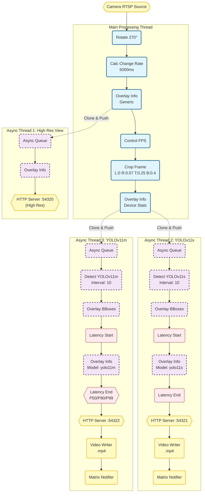

# Matrix Pipeline

MatrixPipeline is a modular, high-performance C++ computer vision application.
It utilizes a configurable Pipeline
Pattern that allows video frames (a.k.a. "matrix") flow through it.

This architecture creates a "T-junction" flow: lightweight tasks like rotation
and cropping run in real-time, while
heavy operations—such as YOLOv11 object detection, MP4 encoding, and network
I/O—are offloaded to isolated threads to
prevent frame drops. Key capabilities include multi-resolution MJPEG streaming,
motion-triggered recording, Matrix chat
alerts, and MQTT publishing, all defined via a flexible JSON configuration.



## Dependencies

- [vcpkg.json](./vcpkg.json)
- `v4l-utils`: for manually examining and manipulating local video devices.
- `OpenCV`: Check build notes [here](etc/build-notes.md)
  and [here](https://github.com/alex-lt-kong/the-nitty-gritty/tree/main/c-cpp/cpp-only/06_poc/05_cuda-vs-ffmpeg).
- [TensorRT](https://developer.nvidia.com/tensorrt/download)

## Build and deployment

```bash
mkdir ./build
cmake ../
make -j2
```

## Quality assurance

- The repo is tested with `Valgrind` from time to time:
  `valgrind --leak-check=yes --log-file=valgrind.rpt ./build/mp`.

### CTest

```bash
cmake -S tests -B build/tests -DCMAKE_TOOLCHAIN_FILE="$HOME/repos/vcpkg/scripts/buildsystems/vcpkg.cmake"
cmake --build build/tests --parallel
ctest --test-dir build/tests --output-on-failure
```
